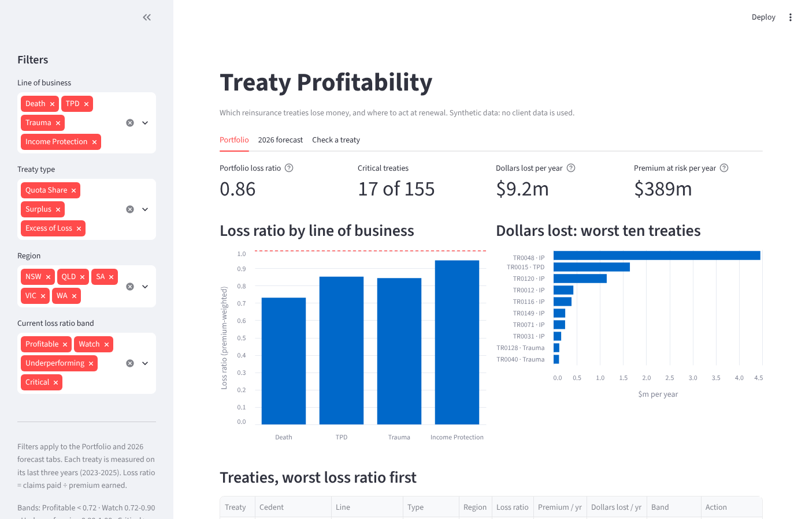

# Treaty Profitability

**Seventeen of 155 reinsurance treaties lose money on claims alone, costing about $9.2m a year. Ten of them are Income
Protection ($7.2m), and three treaties account for 79% of the loss.** Line of business is the strongest driver: an Income
Protection treaty runs a loss ratio about 0.26 higher than an equivalent Death treaty.

> All data is synthetic, produced by `generate_data.py`. No client data was used.



**Live dashboard:** [treaty-profitability-uq.streamlit.app](https://treaty-profitability-uq.streamlit.app)

**Code:** [github.com/shreya17201/Treaty-profitability](https://github.com/shreya17201/Treaty-profitability)

## The business problem

A reinsurer takes a share of an insurer's risk in exchange for a share of its premium. Some treaties make money and some
lose it, and the losers are not obvious from headline premium. A pricing team deciding what to reprice or drop at renewal
needs to know **which treaties are unprofitable and why**, not just a prediction that one will be.

## Data

Synthetic, by design. `generate_data.py` (fixed seed) writes two tables: `treaties.csv` (155 treaties: cedent, type, line
of business, cession, retention, commission, region) and `treaty_year.csv` (1,167 treaty-years, 2016-2025: premium,
claims, claim counts, size, expenses). It builds in plausible relationships for the Australian life market (Income
Protection and Trauma run worse than Death, older treaties deteriorate, large claims drive bad years, size reduces
volatility) plus two deliberate decoys (cession share and region, which should have no effect) and deliberate data
problems to clean (duplicates, impossible values, messy names, missing values).

## Method

1. **Exploration and cleaning** (`notebooks/01_eda.ipynb`): four documented cleaning decisions, seven figures, hypotheses.
2. **Baseline, then OLS regression** (`notebooks/02_regression.ipynb`): predict-the-average baseline; statsmodels OLS on an
   80/20 split; residual, Q-Q, VIF and Cook's distance checks, with robust standard errors where variance is not constant.
3. **Segmentation and 2026 forecast** (`notebooks/03_segmentation.ipynb`): three-year loss ratio per treaty, dollars
   lost, bands with data-driven thresholds, cross-tabulation, recommendation; then a forecast of each treaty's 2026 loss
   ratio and chance of losing money, validated with a time-based backtest (train on 2016-2024, predict 2025).
4. **SQL layer** (`sql/`): the same portfolio questions in DuckDB SQL (window functions, CTEs, `FILTER`, `RANK`/`NTILE`).
5. **Dashboard** (`app.py`): Streamlit, three tabs.
   - **Portfolio** reads `outputs/treaty_results.csv`: headline numbers, filters, worst treaties, coloured bands.
   - **2026 forecast** reads `outputs/treaty_forecast.csv`: every treaty's expected 2026 loss ratio, chance of losing
     money and expected shortfall, ranked by risk.
   - **Check a treaty**: type in a treaty's line, type, age, expected large claims, size and premium; it shows the expected
     loss ratio, chance of losing money, band, recommended action and a breakdown of how each driver moves the ratio. It applies the regression
     coefficients saved by notebook 02 (`outputs/model_coefficients.csv`) with plain arithmetic, so no model file is
     loaded and nothing entered is stored.

Linear regression was chosen on purpose: the deliverable is an explanation a pricing committee can act on, and
coefficients give direction and size in real units.

## Results

| Driver | Effect on loss ratio | Significant? |
|---|---|---|
| Income Protection (vs Death) | +0.26 | yes |
| Trauma (vs Death) | +0.17 | yes |
| TPD (vs Death) | +0.11 | yes |
| Each large claim | +0.13 | yes |
| Each year of treaty age | +0.017 | yes |
| Excess of Loss / Surplus (vs Quota Share) | +0.07 / +0.05 | yes |
| Size, cession %, region | about 0 | no, as expected |

The model cuts prediction error by 17% against the baseline (test RMSE 0.192 vs 0.231; test R² 0.31).

**Forecast.** Trained on 2016-2024 and tested on 2025, the model was 13% more accurate than the portfolio average and
ranked loss-making treaties with an AUC of 0.72 (0.57 using each treaty's own history). It was too optimistic (16%
predicted to lose money, 23% did), so its 2026 chances are best read as a ranking. For 2026 it expects a claims
shortfall of about $21m, mostly Income Protection, with 45 treaties slipping into a worse band. The residuals fan out
for small treaties (non-constant variance), so conclusions were confirmed with robust (HC3) standard errors.

## How to run

```bash
git clone https://github.com/<your-username>/treaty-profitability.git
cd treaty-profitability
python3 -m venv venv
source venv/bin/activate              # Windows: venv\Scripts\activate
pip install -r requirements.txt
pip install ipykernel                 # to run the notebooks

python generate_data.py               # 1. data/ (not committed)
# 2. run notebooks/01_eda.ipynb, 02_regression.ipynb, 03_segmentation.ipynb in order
python sql/load_data.py               # 3. optional: SQL layer
python sql/run.py 03_worst_performers.sql
streamlit run app.py                  # 4. dashboard
```

## Repo structure

```
treaty-profitability/
├── generate_data.py          builds the synthetic treaty data
├── data/                     generated CSVs (not committed)
├── notebooks/
│   ├── 01_eda.ipynb          explore, clean, plot
│   ├── 02_regression.ipynb   baseline, OLS, assumption checks
│   └── 03_segmentation.ipynb which treaties, which segments, recommendation
├── sql/
│   ├── load_data.py          CSV -> DuckDB (raw tables + cleaned views)
│   ├── 01_portfolio_summary.sql
│   ├── 02_loss_ratio_by_treaty.sql
│   ├── 03_worst_performers.sql
│   ├── run.py                runs any .sql file and prints the table
│   └── README.md
├── outputs/
│   ├── figures/              charts saved from the notebooks
│   ├── treaty_results.csv    portfolio results (notebook 03), read by the dashboard
│   ├── treaty_forecast.csv   2026 forecast per treaty (notebook 03), read by the dashboard
│   ├── forecast_backtest.json 2025 backtest results shown under the forecast
│   ├── model_coefficients.csv regression coefficients (notebook 02), used by "Check a treaty"
│   ├── model_residuals.csv   training residuals, used for the chance of losing money
│   └── model_summary.json    test RMSE, R² and size bands
├── app.py                    the dashboard
├── requirements.txt
├── .gitignore
└── README.md
```

## Limitations

Synthetic data, so the findings demonstrate the method rather than describe a real portfolio. Loss ratio is bounded below
by zero but OLS treats it as unbounded; residuals are right-skewed (large claims) and fan out for small treaties; three
years is a short window for small, volatile treaties. The forecast under-predicted losses in its backtest, because the
book deteriorates faster than a model fitted on earlier years assumes. With real data: more history, claim-level detail, and a time-based
validation split to forecast rather than explain.

*All data in this repository is synthetic. No client data was used.*
